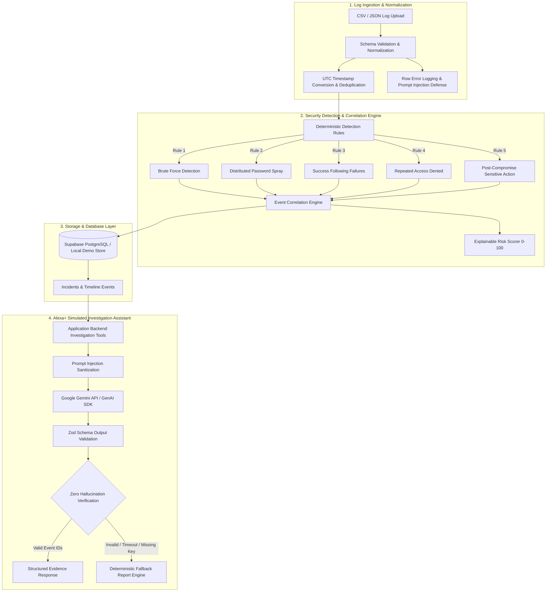

# Root & Reason — AI Incident Investigator

[](LICENSE)
[](https://nextjs.org/)
[](https://www.typescriptlang.org/)
[](https://ai.google.dev/)
[](https://developer.amazon.com/docs/adbt/get-started)

> **Amazon Developer Hackathon — Build, Ship, Shape**  
> **Selected Track:** Alexa+ Simulated Web Experience  
> **Development Tooling:** Amazon Devices Builder Tools (ADBT MCP & Agent Skills)

---

## 1. Executive Summary

**Root & Reason** is an interactive, evidence-backed AI incident investigation platform for Security Operations Center (SOC) teams. It accepts raw security logs (CSV/JSON), parses and normalizes events to UTC, executes deterministic detection rules in TypeScript, correlates related events into deduplicated incidents, calculates an explainable 0–100 risk score, and powers an **Alexa+ simulated conversational security copilot**.

Unlike generic chatbot dashboards, Root & Reason connects directly to verified backend event records. Every finding, timeline progression, and hypothesis cited by Google Gemini is programmatically checked against actual backend log records to eliminate hallucinations.

---

## 2. Architecture & Data Flow



---

## 3. Mandatory Technology Stack

| Layer | Technologies |
|---|---|
| **Frontend & Framework** | Next.js 16.4.2 (App Router, Turbopack, Partial Prerender), React 19, TypeScript (strict) |
| **Styling & UI** | Tailwind CSS 4, Custom Dark SOC Theme (`#080c14`, `#0d1527`, `#06b6d4`), Lucide React |
| **Database & Auth** | Supabase PostgreSQL, `@supabase/ssr`, `@supabase/supabase-js`, Row Level Security (RLS) |
| **AI Engine** | Google Gemini (`@google/genai` official SDK), Zod Structured Outputs, Zero-Hallucination Evidence Verifier |
| **Security Core** | PapaParse, Deterministic Rule Engine, Event Correlation Engine, Overlap-Dampened Risk Scorer |
| **Testing** | Vitest 5 (14 unit tests, 100% passing) |
| **Developer Tooling** | Amazon Devices Builder Tools (ADBT MCP `@amazon-devices/amazon-devices-buildertools-mcp@1.0.17`) |

---

## 4. Key Capabilities & Features

### A. Resilient Log Ingestion
- Accepts CSV and JSON files up to 5MB / 5,000 records.
- Normalizes disparate fields into `event_id`, `timestamp` (UTC ISO-8601), `event_type`, `username`, `source_ip`, `host`, and `result` (`SUCCESS`, `FAILURE`, `DENIED`, `UNKNOWN`).
- Actionable error reporting with downloadable JSON for malformed lines.
- Built-in 1-click synthetic presets for immediate demonstration.

### B. Deterministic Detection Rules
1. **`RULE_BRUTE_FORCE_USER`**: $\ge 4$ failed logins for the same user within 15 minutes (MITRE ATT&CK `T1110.001`).
2. **`RULE_PASSWORD_SPRAY_IP`**: Single origin attacking $\ge 3$ distinct accounts within 15 minutes (`T1110.003`).
3. **`RULE_SUCCESS_AFTER_FAILURES`**: Successful login following $\ge 3$ failures (Account Compromise, `T1078`).
4. **`RULE_REPEATED_ACCESS_DENIED`**: $\ge 3$ authorization rejections within 15 minutes (`T1068`).
5. **`RULE_SUSPICIOUS_POST_COMPROMISE`**: Sensitive action (`DATA_EXPORT`, `ADMIN_ROLE`) within 60 minutes after auth failures (`T1020`).

### C. Event Correlation & Explainable Risk Scoring
- Clusters events by shared entity (username, source IP, host) within temporal sliding windows.
- Generates stable, idempotent incident identifiers (`inc_qm05jc`).
- Computes an explainable 0–100 score with confidence estimation and attenuation for overlapping rules on identical event IDs to prevent artificial score inflation.

### D. Alexa+ Simulated Conversational Copilot
- Simulates an authoritative conversational security assistant.
- Voice speech synthesis simulation (Web Speech API toggle).
- Suggested SOC query chips:
  - *"Investigate the suspicious login incident involving analyst01."*
  - *"Show me the evidence behind the high risk score."*
  - *"What happened before the successful login?"*
  - *"What should an analyst verify next?"*
  - *"Generate the investigation report."*
- Explicit structural separation of **Verified Facts**, **Analytical Hypotheses**, and **Actionable Recommendations**.
- Cites genuine event IDs with click-to-highlight timeline linkage.

### E. Zero-Hallucination & AI Fallback
- `EvidenceManager.verifyEvidenceReferences` audits all event IDs generated by the LLM against the incident's genuine event set.
- If Gemini API key is missing, times out, or hallucinates IDs, the engine immediately yields a deterministic, evidence-backed report clearly tagged with `generation_method: 'deterministic_fallback'`.

---

## 5. Quick Start (Windows / macOS / Linux)

### Prerequisites
- Node.js `v20+` or `v24+` (tested on `v24.22.0`)
- npm `v10+` or `v11+`

### 1. Installation
```powershell
npm install
```

### 2. Environment Configuration (Optional)
The application operates fully out-of-the-box with built-in synthetic fixtures and deterministic fallback reporting. To connect live Supabase or Google Gemini:

```powershell
cp .env.example .env.local
```

Populate `.env.local`:
```env
NEXT_PUBLIC_SUPABASE_URL=https://your-project.supabase.co
NEXT_PUBLIC_SUPABASE_PUBLISHABLE_KEY=your-supabase-anon-key
GEMINI_API_KEY=your_gemini_api_key_here
GEMINI_MODEL=gemini-2.5-flash
```

### 3. Run Unit Tests
```powershell
npm test
```
*Executes all 14 unit tests across parser, detection engine, and correlation/scoring.*

### 4. Production Build & Start
```powershell
npm run build
npm start
```
Open **[http://localhost:3000](http://localhost:3000)** in your browser.

---

## 6. End-to-End Demonstration Walkthrough

1. **Dashboard (`/dashboard`)**:
   - Observe live SOC metrics: Total events processed, Correlated incidents, Average risk score, and High/Critical alert count.
2. **Log Ingestion (`/logs`)**:
   - Click **"Brute Force → Success → Exfil"** (or drag & drop your own CSV/JSON file).
   - Review the ingestion summary: accepted vs rejected rows, timestamp normalization.
3. **Incident Queue (`/incidents`)**:
   - Filter by severity (Critical / High / Medium).
   - Notice the correlated incident: *Potential Post-Compromise Activity for analyst01 (198.51.100.42)* with an 85/100 risk score.
4. **Interactive Investigation (`/incidents/[incidentId]`)**:
   - View the visual chronological timeline of 6 verified events.
   - Click the prompt chip: *"What happened before the successful login?"* in the Alexa+ Copilot.
   - Review the structured answer: 4 failed attempts (`evt_sec_101`–`evt_sec_104`) leading up to the successful login (`evt_sec_105`).
   - Click event ID badges to inspect raw JSON payloads.
   - Click *"Generate Investigation Report"* to view the audit document and download Markdown (`Investigation_Report_[id].md`).

---

## 7. Amazon Devices Builder Tools (ADBT) Integration

During the development of Root & Reason, Amazon Devices Builder Tools was initialized and verified:
- **Command executed**: `npx -y @amazon-devices/amazon-devices-buildertools-mcp@latest init-context --agent gemini-cli --force`
- **MCP Version**: `1.0.17`
- **Result**: Context Document `v7.0` installed at `.gemini/GEMINI.md`, 19 developer skills configured, MCP server registered in `~/.gemini/settings.json`.
- **Status check**: `npx -y @amazon-devices/amazon-devices-buildertools-mcp@latest check-status` verified `✅ Fully configured`.
- **Friction Log**: Documented in `docs/HACKATHON_SUBMISSION.md` (e.g. Git dependency check on Windows, pre-existing folder conflicts).

---

## 8. License

This project is licensed under the MIT License — see the [LICENSE](LICENSE) file for details.
